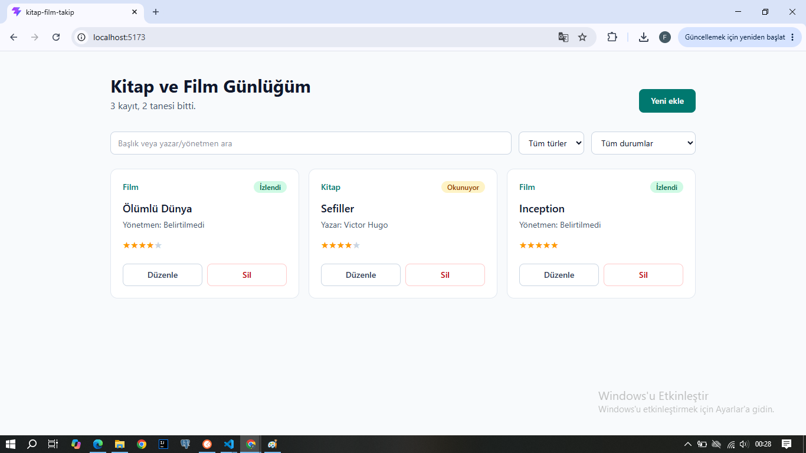
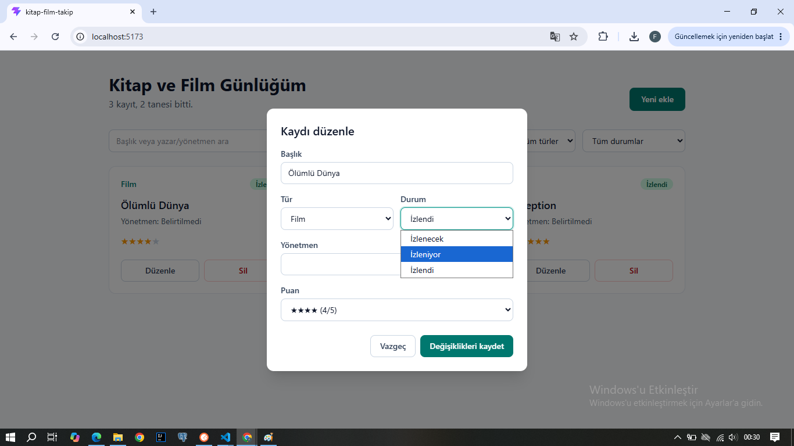
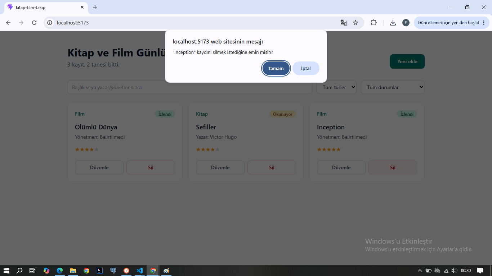
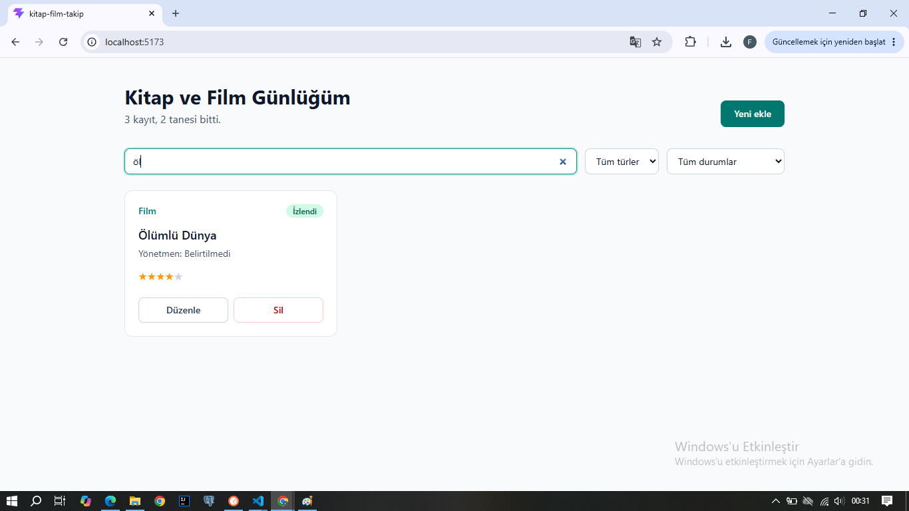

# Kitap ve Film Günlüğüm

React, TypeScript, Vite ve Tailwind CSS ile geliştirilmiş kitap/film takip uygulaması. Veriler tarayıcının localStorage alanında saklanır.

## Özellikler

- Ekle: başlık, tür, yazar/yönetmen, durum ve puan ile yeni kayıt
- Listele: kartlar halinde listeleme, arama, tür ve durum filtresi
- Güncelle: karttaki "Düzenle" butonu ile kaydı değiştirme
- Sil: onay sorarak kaydı silme

## Kullanılan teknolojiler

- React
- TypeScript
- Vite
- Tailwind CSS
- localStorage

## Kurulum

```bash
npm install
npm run dev
```

## Yayına alma (Netlify)

1. Projeyi GitHub'a yükle
2. Netlify'da "Add new site > Import an existing project" seç
3. Build komutu: `npm run build`, publish dizini: `dist`

## Proje yapısı

```
src/
├── components/   FilterBar, MediaCard, MediaForm, MediaList
├── hooks/        useMedia (CRUD mantığı)
├── interfaces/   media.ts (tipler)
├── pages/        Home
└── utils/        storage.ts, labels.ts
```
## Ekran görüntüleri

### Listeleme ve ekleme


### Güncelleme


### Silme


### Filtreleme
